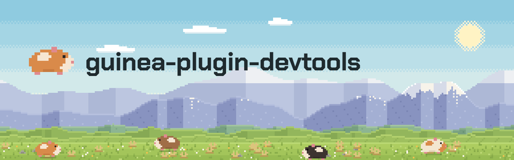

Lets [guinea devtools](../../tools/devtools) look inside a running guinea
application: its routes and segments, actors and state, the trace of what set
off what, timers and the global bus, what the async runtime's workers are
busy with by tokio's own counters - and, through the native inspector, the UI
tree and its frames.

```rust
use guinea_plugin_devtools::{DevToolsConfig, DevToolsPlugin};

app.plugin::<DevToolsPlugin>(DevToolsConfig::new().for_app(meta))?;
```

Devtools listen; the application connects, and keeps trying while devtools
are not running. Nothing is traced or read until devtools answer, and it
stops when they go: an application that has the plugin and no devtools runs
nothing for it. While they are there, they are sent everything once and then
only what guinea says moved: the trace a short wait after it happened, the
state that moved at most once a second, however often it moves.

| Setting | What it does |
|---|---|
| `.every(ms)` | How long after something moves devtools are told, so that a burst goes as one report. 50 ms |
| `.reread(ms)` | How often at most state that keeps moving is read again. 1000 ms |
| `.launch(true)` | Starts devtools when they are not running: `GUINEA_DEVTOOLS_BIN`, or `guinea-devtools` from the `PATH` |
| `.in_release(true)` | Connects in a release build too |

In a release build the plugin does nothing unless `in_release` says
otherwise: devtools can call the application's remote actions, and a build
shipped to users should not listen for that because a line was left in.

What goes over the wire is [`guinea-devtools-protocol`](../devtools-protocol).

The plugin observes guinea 0.36 through the application's `Observed` handle.
It rebuilds its view on reconnect and sends changes after the initial snapshot.
The optional `profiling` feature serves explicit puffin instrumentation; guinea's
old core puffin zones no longer exist. Native backend profiling remains separate.

### Ignoring a named source in trace reports

Use `DevToolsConfig::new().ignore_source("activity-refresh")` for a source given
that exact `.named("activity-refresh")` name. Repeat for several names; all
same-named sources match. The default still reports everything.

Routine source lifecycle, pull/arrival records and their causal descendants are
excluded before sending trace reports. Explicit actions and application log/span
branches remain, reattached to the nearest retained cause. Source registration,
Snapshots/Changes, actor state and Perfetto recording are unaffected.

The filter learns initial sources on connection and keeps bounded correlation
state (16,384 sources and causes each). Unknown or evicted causes fail open:
some traffic can remain if a parent arrives in a later batch or observation loses
records. Ends with a known hidden start are omitted; unknown Ends pass through so an
older retained long-running span can still finish. Filtering does not reduce
the cost of recording the original trace, and does not suppress frequent snapshots.
