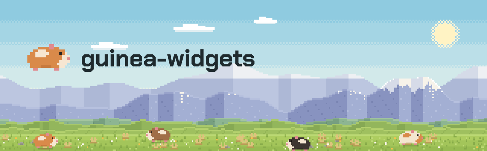

Widgets for guinea applications: tables, charts, drag-resize handles.

Not a plugin - nothing here installs into an application, it is a set of
components a page holds as fields and draws. It lives beside the plugins
because it varies on the same axis they do: the backend is a feature, and the
parts that are pure layout or geometry stay available without one.

| Module | What it has |
|---|---|
| `table` | A table whose columns sort, resize and reorder - reported to the page, which keeps the widths; `SortState` without a backend |
| `chart` | A line chart, live or still, drawn with Direct2D; `RingSeries` without a backend |
| `chart::scatter` | Points in time against a value, on a linear or log scale, with named bands past its ends; hover, brush and click |
| `painted` | A view drawn with Direct2D that the page keeps as a field, with the pointer handed back |
| `resize` | The drag handle that resizes a column |

A scatter reads the page's own data where the page keeps it - anything that
implements `ScatterData` behind an `Rc` - and keeps no copy: handing the same
`Rc` again is no change, and data that knows its points' order can answer
`points_between` by search, so hovering and drawing ask only for the points
near the pointer and on screen.

```rust
scatter.publish(Rc::clone(&self.points), ScatterOptions { x: (from, to), ..ScatterOptions::default() });
```

## Features

| Feature | |
|---|---|
| `winui` (default) | The WinUI views, on `windows-reactor-pre` and `windows-canvas-pre` |

Without it, what is left is what needs no backend: sort state and ring
series. The charts' geometry needs it for now: a `Series` carries a Direct2D
colour.

`cargo run -p guinea-widgets --example scatter` shows a scatter chart.

## Progressive scatter rendering

Large scatter snapshots can opt into a soft submission budget:

```rust
chart.set_frame_budget(Some(std::time::Duration::from_millis(4)));
chart.publish(std::rc::Rc::clone(&data), options);
```

The data provider opts in by implementing the additional object-safe method:

```rust
fn cursor(self: std::rc::Rc<Self>, from: u64, to: u64)
    -> Option<ScatterCursor<ProcessKey>>;
```

`ScatterCursor<K>` is a boxed, owned `Iterator<Item = (usize, ScatterPoint<K>)>`:
series index and point. It must retain its immutable snapshot, yield in the same
series-major order as ordinary rendering, and resume from stored indices. Bounds
are inclusive and include marker overhang. Creating it and each `next()` must do
bounded work; rebuilding a prefix, `skip(N)` from the start on every frame, or
flattening the whole dataset on the UI thread defeats the budget. The default
implementation returns `None`, preserving eager drawing for existing providers.
`None` or a zero budget also disables progressive rendering.

Each job freezes its data and transform and submits markers into an owned GPU
bitmap on WinUI `CompositionTarget.Rendering`. It clears that bitmap once, not
on every portion. The last complete front remains visible until the back is
finished. New publications replace one pending snapshot; they do not restart
the current job. Ordinary live clock and tick-label changes are pending updates.
Changing the time-window length, non-live range, scale, theme, size or DPI cancels
the job and invalidates the old front. Initial/invalidated views draw their axes
first; no partially drawn dataset is exposed. A subscription is revoked when no
work remains, and unmount releases the job and device-bound resources.

Hover and hit testing use the displayed front's snapshot and transform. Brushing
pins that front until the gesture ends; new data still replaces the pending
snapshot. Pointer overlays do not resubmit the complete point set. This does not
make the provider's hit-test traversal itself incremental.

The budget is **soft**: device/bitmap allocation, a slow provider, OS scheduling,
native `BeginDraw`/`EndDraw` and final copying can exceed it. `render_stats()`
reports job completions/cancellations, requested/front revisions, and maximum
CPU wall times for initialization, submission, offscreen finish and surface
passes. Finish timings include the native call and wrapper restoration; they
are not GPU execution times. A completed front is ready to present, not proof
of physical display presentation. Live rendering can complete multiple jobs of
the same publication revision as its clock advances.

A native same-binary diagnostic with 100,000 Activity points, 200 virtualized
rows and publications every 250 ms measured median steady maximum UI callback
gaps of **320.711 → 47.915 ms** and p95 gaps of **212.612 → 23.752 ms** over three
pairs. Jobs completed without cancellation from ordinary updates and caught up
to the last request after draining. This measures UI responsiveness on that
machine, not a general throughput or frame-rate guarantee. Cold mount/device
work remains; incremental submission does not remove that cost.
